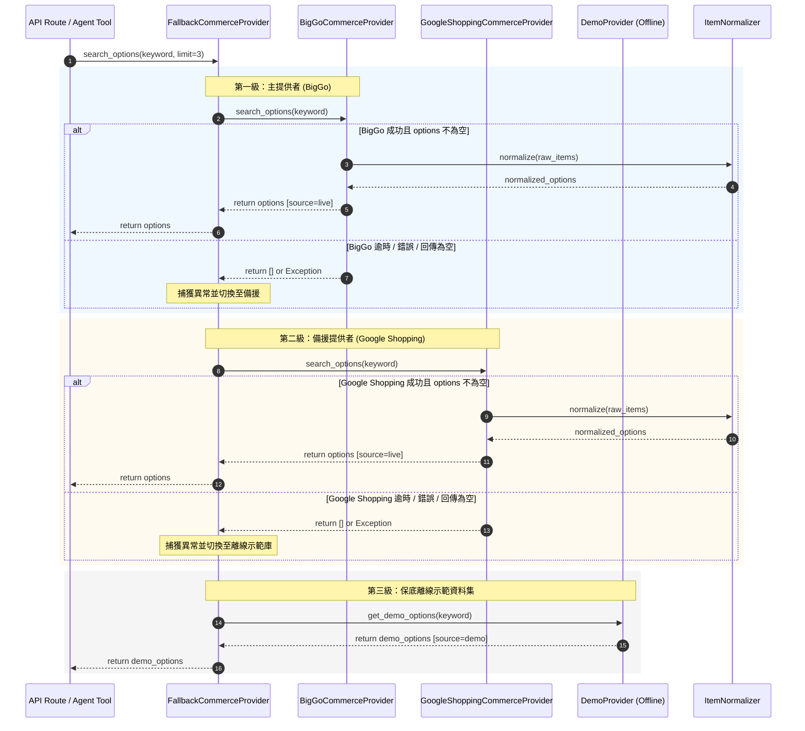

# [MODULE: COMMERCE] 電商比價與採購選項推薦模組規格書 (Living Spec)

- **模組識別**: `commerce`
- **負責角色**: `A2` (Vision, Normalizer & Commerce Provider)
- **維護狀態**: `[DELIVERED]`
- **最後更新**: 2026-11-14

---

## 1. 模組願景與邊界 (Vision & Scope)

### 1.1 業務願景
為 Nestock 提供高可用、低延遲且具備多源自動容錯降級能力的商品採購比價與規格推薦服務。當主比價渠道 (BigGo) 因網路逾時、配額耗盡或無憑證而無法提供有效結果時，系統自動容錯降級至備用渠道 (Google Shopping)，確保使用者獲得可靠的候選採購選項 (Purchase Options)。

### 1.2 邊界矩陣 (Boundary Matrix)

| 範疇類型 | 項目清單 | 權威職責 |
| :--- | :--- | :--- |
| **納入範疇 (In-Scope)** | 1. 外部電商與比價來源搜尋介接 (BigGo API, Google Shopping / SerpApi)。<br>2. 統一抽象契約 `BaseCommerceProvider` 與串接調度鏈 `FallbackCommerceProvider`。<br>3. 外部商品標題去噪、單位解析與正規化 (`ItemNormalizer`)。<br>4. 輸出結構化暫態 DTO `PurchaseOption` 與 `CommerceSearchResponse`。<br>5. 降級至內建 Demo 離線資料集以達成零非受控崩潰 (Zero Unhandled 500)。 | A2 (Commerce Provider Adapter) |
| **排除範疇 (Out-of-Scope)** | 1. 任何形式之價格持久化至 Cosmos DB 或 `ShoppingItem` (嚴格禁止)。<br>2. 訂單建立、購物車結帳、支付介接與外部代購操作。<br>3. Agent HITL 審批卡片持久化與狀態機生命週期 (A1 權責)。<br>4. 前端 UI 比價卡片渲染與動畫展示 (C2 權責)。 | 全系統硬不變量與跨領域隔離 |

---

## 2. 核心架構不變量 (Architecture Invariants)

1. **[INVARIANT-A2-1: ADAPTER_TRANSPARENCY]**
   所有比價適配器均實作統一介面 `BaseCommerceProvider`，上層業務邏輯與 API 控制器僅依賴抽象介面，無需感知當前是由主源、備援源或 Demo 資料集提供服務。
2. **[INVARIANT-A2-2: ZERO_PRICE_PERSISTENCE]**
   `PurchaseOption.estimated_price` 純屬展示用之暫態數值。價格嚴禁持久化至 `ShoppingItem`、`InventoryItem` 或交易紀錄資料庫。
3. **[INVARIANT-A2-3: CANONICAL_NORMALIZATION]**
   所有外部提供者回傳之原始商品標題 (`raw_title`)，強制經由 `ItemNormalizer` 洗滌促銷雜訊（例如「下殺」、「現貨」、「免運」）並提取標準計量單位（例如「入」、「包」、「ml」），產生乾淨之 `title`。
4. **[INVARIANT-A2-4: FAULT_TOLERANT_DEGRADATION]**
   主源 (BigGo) 呼叫逾時、HTTP 4xx/5xx、驗證失效或無回傳結果時，自動平滑切換至備用源 (Google Shopping)；若備用源亦無法滿足，則平滑降級至離線 Demo 資料集。對外端點嚴禁拋出 500 Unhandled Exception。
5. **[INVARIANT-A2-5: DEMO_INTEGRITY]**
   `PurchaseOption.source` 欄位必須精確標示 `"live"` 或 `"demo"`，嚴格禁止離線假資料偽裝為即時線上數據。
6. **[INVARIANT-A2-6: PRICE_ASCENDING_ORDER]**
   所有比價適配器回傳之有效候選選項，一律強制依 `estimated_price` 由低至高排序 (Price Ascending，Cheapest First)，無標價者墊後，再行截取前 3 筆回傳，落實比價推薦之實質效益。
7. **[INVARIANT-A2-7: LOSS_LEADER_AND_BAIT_DEFENSE]**
   所有比價適配器（BigGo 與 Google Shopping）均強制實施反引流三重防禦：
   - **行銷誘餌防禦**: 過濾促銷誘餌關鍵字黑名單（首購/試用/體驗/加價購/樣品/贈品/抽獎/盲盒）。
   - **配件逃逸防禦**: 過濾周邊耗材與配件關鍵字黑名單（`ACCESSORY_KEYWORDS`，如袋蓋/密封蓋/封口夾/分裝袋/量勺/壓頭等），避免使用者搜尋主體食材或耗品時被低價配件霸榜。
   - **價格下限防護**: 排除標價低於 NT$ 35.0 之非正常引流樣品，保證推薦選項皆為正規家庭常備正品規格。

---

## 3. 領域模型與資料契約 (Domain Models & Schema)

### 3.1 DTO 契約定義

#### 3.1.1 `CommerceSearchStatus` (列舉)
- `SUCCESS`: 搜尋成功且包含至少一筆候選選項。
- `NO_MATCH`: 搜尋正常執行但無相符之有效商品。
- `UNAVAILABLE`: 所有外部提供者皆不可用、逾時或連線失敗。

#### 3.1.2 `PurchaseOption` (領域實體模型)
| 欄位名稱 | 型別 | 約束條件 | 說明 |
| :--- | :--- | :--- | :--- |
| `option_id` | `str` | `min_length=1` | 選項唯一識別碼 (例如: `opt-biggo-1`, `opt-gshop-1`, `opt-demo-1`) |
| `title` | `str` | `min_length=1` | 去噪後之正規化商品標題 |
| `raw_title` | `str \| None` | 預設 `None` | 原始提供者商品標題 (領域實體完整保留，對外 API 藉由 View 隔離) |
| `store` | `str` | `min_length=1` | 商家或平台名稱 (例如: `momo`, `PChome`, `Coupang`) |
| `source` | `Literal["live", "demo"]` | 強型別二元枚舉 | 資料來源屬性，實時或離線示範 |
| `estimated_price` | `float \| None` | `ge=0.0` | 參考市價 (新台幣)，僅供展示 |
| `product_url` | `str` | `min_length=1` | 外部導購深層連結 (Deep-link) |
| `unit_spec` | `str \| None` | 預設 `None` | 解析所得包裝與單位規格 (例如: `100抽x8包`) |
| `image_url` | `str \| None` | 預設 `None` | 商品縮圖 URL |
| `updated_at` | `str \| None` | ISO 8601 時間字串 | 報價取得時間戳記 |

#### 3.1.3 `CommerceOptionView` (表現層 DTO)
繼承自 `ContractModel`，欄位與 `PurchaseOption` 相同，但不包含 `raw_title`，確保 API 輸出邊界乾淨隱藏內部除錯標題。

#### 3.1.4 `CommerceSearchResponse` (封裝回應)
- `status`: `CommerceSearchStatus`
- `code`: `str` (狀態代碼，例如: `"COMMERCE_OPTIONS_FOUND"`, `"COMMERCE_SEARCH_FAILED"`)
- `message`: `str` (人類可讀之描述)
- `options`: `list[CommerceOptionView]` (最多回傳 3~5 筆推薦項目)

---

## 4. 服務架構與調度流程 (Architecture & Flow)

### 4.1 提供者拓撲與抽象介面
```text
backend/app/services/commerce/
  ├── __init__.py                (導出統一調度器與工廠)
  ├── base.py                    (定義 BaseCommerceProvider Protocol)
  ├── biggo.py                   (BigGo 主源適配器，委託 demo_data)
  ├── google_shopping.py         (Google Shopping 備援適配器)
  ├── fallback.py                (Fallback 調度器: BigGo -> Google Shopping -> Demo)
  └── demo_data.py               (SSOT 示範資料庫: 洗衣精/麵粉/牙膏/衛生紙/鮮奶/醬油)
```

### 4.2 調度時序與容錯流程



---

## 5. 異常狀態與防護矩陣 (Fault Handling Matrix)

| 情境編號 | 異常觸發條件 | 處置方式 | 外部 HTTP 行為 |
| :--- | :--- | :--- | :--- |
| **FH-01** | `BIGGO_CLIENT_ID` / `SECRET` 未設置 | 自動略過 BigGo，直接轉交 Google Shopping 處理 | 正常 200 OK，無中斷感 |
| **FH-02** | BigGo 請求連線逾時 (> 5.0 秒) | 記錄 Warning 日誌，中斷請求並切換至 Google Shopping | 正常 200 OK，無中斷感 |
| **FH-03** | BigGo 回傳 401 Unauthorized / 429 Rate Limit | 標記憑證無效或配額已滿，切換至 Google Shopping | 正常 200 OK |
| **FH-04** | Google Shopping 未設置 Key 或連線逾時 | 記錄 Warning 日誌，切換至 Demo 離線資料集 | 正常 200 OK，`source="demo"` |
| **FH-05** | 查詢關鍵字為空白或純空白符號 | 立即回傳空清單 `[]`，不發送外部網路請求 | 正常 200 OK，`options=[]` |
| **FH-06** | 外部商品無有效定價或價格異常 (< 0) | 將 `estimated_price` 設為 `None`，不中斷整體比價 | 正常 200 OK，欄位為 null |
| **FH-07** | 外部導購連結非以 `http` 開頭 (相對路徑或無效協議) | 強制剔除該候選項目，避免前端產生無效導購跳轉 | 正常 200 OK，僅保留合法項目 |
| **FH-08** | 外部商家欄位為巢狀 `dict` (包含名稱與圖示) | 防禦性提取 `dict.get("name")`，確保字串純度 | 正常 200 OK，乾淨商家名稱 |
| **FH-09** | 外部商品標題命中行銷誘餌關鍵字 (首購/試用/加價購/樣品) | 強制剔除該引流商品，保留正規正品 | 正常 200 OK，排除虛假低價 |
| **FH-10** | 外部商品標價低於最低合理下限 (`price < 35.0`) | 強制剔除極端引流款或試用包，保證家庭正品規格 | 正常 200 OK，正規市價區間 |

---

## 6. 驗收與測試基準 (Acceptance & Verification)

1. **單元測試 (`test_commerce_fallback.py`)**：
   - 驗證當 BigGo 成功時，回傳 BigGo 結果，不觸發 Google Shopping。
   - 驗證當 BigGo 逾時或拋出 HTTP 錯誤時，成功取得 Google Shopping 產出。
   - 驗證當 BigGo 與 Google Shopping 皆失敗時，成功降級至 Demo 資料集，`source` 為 `"demo"`。
   - 驗證零價格持久化：檢查整個呼叫鏈中無寫入 Cosmos DB 的行為。
2. **整合測試 (`test_commerce_routes.py`)**：
   - `GET /api/commerce/options?keyword=衛生紙` 驗證回傳 JSON 符合 `CommerceSearchResponse` Schema。

